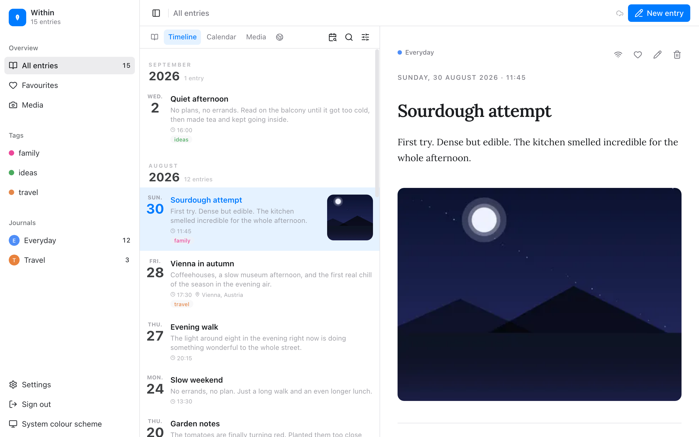
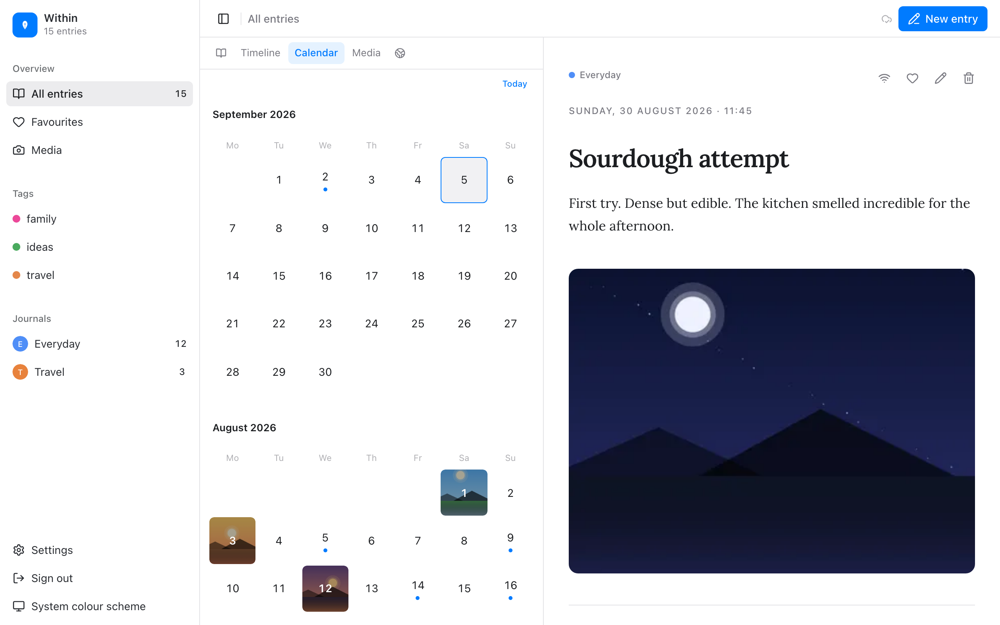
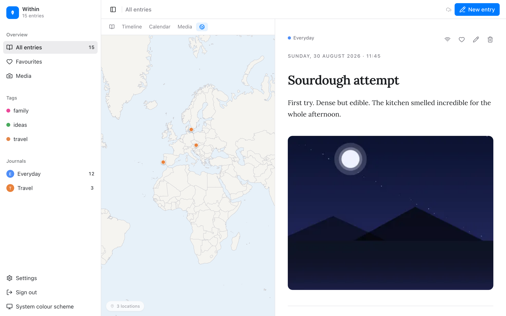
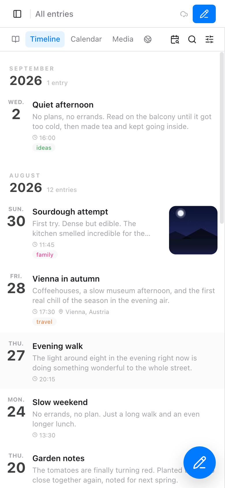

# Within

**A private journal that never leaves your home.** Within runs on a small server in your own network — a Raspberry Pi, a NAS, an old laptop — and you write from your phone or computer. No cloud, no account, no company reading along. *What's within stays within.*



- **Write** text with Markdown, add photos, videos, voice memos and PDF files.
- **Find** entries again: timeline, calendar, map, tags, favourites, full-text search, and "On this day".
- **Take it with you:** install it on your phone as an app. Entries and pinned photos stay readable offline, encrypted on the device behind a PIN, and sync back when you are home.
- **Move in from Day One:** import your existing journal from a Day One export, photos, videos, voice memos and PDF attachments included.
- **Sleep well:** a nightly backup with an automatic restore check is part of the setup, not a chore.
- German, English and French interface.

<p>
  
  
</p>
<p align="center">
  
</p>

---

## What you need

| | |
|---|---|
| **A computer that stays switched on** | This is your *server*. A Raspberry Pi 4 or 5 with **4 GB of memory or more** is ideal. A NAS, a mini PC or a Mac/Windows computer also work, as long as the system is 64-bit. A Raspberry Pi 3 and 32-bit systems do not work. While the server is off or asleep, you cannot reach your journal and the nightly backup does not run. |
| **Disk space** | About 1 GB for the software, plus what your photos and videos need, plus the same again for the nightly backup. |
| **Access to your router** | You give the server a fixed address there (step 2). |
| **30 to 45 minutes** | Most of it is waiting for downloads. |

You do not need to know how to program. Within runs inside Docker, a free program that step 1 installs for you.

Within is built for **one person**. There is one password and one journal owner; two people who want separate diaries need two installations.

## Set up

Do the steps in order and copy the commands exactly. Four things to know before you start:

- **Server** is the always-on computer from the table above.
- **Terminal** is the window where you type commands. Paste a command, press Enter, wait until the cursor comes back.
- **`<address>`** is a placeholder for your server's address from step 2. Write the address in its place, without the angle brackets: `https://<address>` becomes, for example, `https://192.168.1.50`.
- **Commands run on the server.** If your server is a Raspberry Pi, that means the `ssh` window from step 1, even if you are sitting at a Mac or Windows computer. If you closed that window, connect again the same way.

*Already running Portainer on a Linux server?* Follow [Set up with Portainer](#set-up-with-portainer). *Using an AI coding assistant?* See [Set up with an AI assistant](#set-up-with-an-ai-assistant).

### Step 1: Get the server ready

Open the part that matches your server.

<details>
<summary><b>Raspberry Pi, starting from nothing</b></summary>

You need the Pi, its power supply, a microSD card with 32 GB or more, and another computer. The menu names below come from the current Raspberry Pi Imager and can differ slightly in other versions.

1. On the other computer, install **Raspberry Pi Imager** from [raspberrypi.com/software](https://www.raspberrypi.com/software/), start it and insert the card.
2. Under *Device* choose your Pi. Under *OS* choose **Raspberry Pi OS Lite (64-bit)**; it is usually listed under *Raspberry Pi OS (other)*. Under *Storage* choose your card.
3. Under *Customisation* set:
   - *Hostname:* `within`
   - *User:* a username and password of your choice. Write both down.
   - *Wi-Fi:* your network name and password. Skip this if the Pi is connected by network cable, which is the more reliable choice.
   - *Remote Access:* turn on **Enable SSH** and choose *Use password authentication*.
4. Select *Write*, confirm with *I understand, erase and write*, and wait until it says it is done.
5. Put the card into the Pi, connect the power, and wait three minutes.
6. On the other computer, open a terminal. On a Mac press Cmd+Space, type `Terminal` and press Enter. On Windows right-click the Start button and choose *Terminal*. Connect, using your own username:

   ```bash
   ssh yourusername@within.local
   ```

   Answer `yes` when asked about the fingerprint, then type your password. **Nothing appears on the screen while you type the password; that is normal.** If the name is not found, open your router's page (on a FRITZ!Box `http://fritz.box`, then *Home Network → Network*), find the device called `within`, and connect with its address instead, for example `ssh yourusername@192.168.1.50`.

From now on, every command goes into this window, including those in steps 2, 3, 4 and 8. Install Docker by pasting these lines **one at a time**, pressing Enter after each and waiting for the cursor to come back. If `sudo` asks for a password, it is the one you just chose:

```bash
curl -fsSL https://get.docker.com -o get-docker.sh
sudo sh get-docker.sh
sudo usermod -aG docker $USER
exit
```

The last line closes the connection on purpose: the new permission only counts after you log in again. Connect again with the same `ssh` command and check:

```bash
docker compose version
```

It should print `Docker Compose version` with a version of 2.23 or newer.

</details>

<details>
<summary><b>Another Linux computer</b></summary>

Open a terminal on it, directly or over `ssh`. Then install Docker by pasting these lines **one at a time**, pressing Enter after each and waiting for the cursor to come back. If `sudo` asks for a password, it is your login password:

```bash
curl -fsSL https://get.docker.com -o get-docker.sh
sudo sh get-docker.sh
sudo usermod -aG docker $USER
exit
```

The last line closes the session on purpose: the new permission only counts after you log in again. Over `ssh`, simply connect again. If you are sitting at the computer itself, closing the terminal is not enough: log out of your desktop and back in, or restart. Then open a terminal and check:

```bash
docker compose version
```

It should print `Docker Compose version` with a version of 2.23 or newer.

</details>

<details>
<summary><b>Mac</b></summary>

1. Install **Docker Desktop** from [docker.com/products/docker-desktop](https://www.docker.com/products/docker-desktop/) and open it. Accept the terms; you can skip signing in. Wait until it says the engine is running.
2. In Docker Desktop under *Settings → General*, turn on *Start Docker Desktop when you sign in to your computer*.
3. In *System Settings* search for *sleep* and turn on *Prevent automatic sleeping*, so the journal stays reachable. If your Mac later asks whether Docker may accept incoming connections, choose *Allow*; otherwise your phone cannot connect.
4. Press Cmd+Space, type `Terminal` and press Enter. Check:

   ```bash
   docker compose version
   ```

   It should print `Docker Compose version` with a version of 2.23 or newer.

</details>

<details>
<summary><b>Windows</b></summary>

1. Install **Docker Desktop** from [docker.com/products/docker-desktop](https://www.docker.com/products/docker-desktop/), keep the suggested options, restart if asked, and open it. Accept the terms; you can skip signing in. Wait until it says the engine is running. If it reports that virtualization is disabled, that has to be switched on in the computer's BIOS settings; otherwise use another computer as the server.
2. In Docker Desktop under *Settings → General*, turn on *Start Docker Desktop when you sign in to your computer*.
3. Under *Settings → System → Power* set sleep to *Never*, so the journal stays reachable. If Windows asks whether Docker may use the network, allow it for private networks.
4. Right-click the Start button and choose *Terminal*. Check:

   ```powershell
   docker compose version
   ```

   It should print `Docker Compose version` with a version of 2.23 or newer.

</details>

<details>
<summary><b>NAS</b></summary>

Whether this works depends on the model. It needs a 64-bit system, Docker with Compose 2.23 or newer, and a way to run commands (usually `ssh`, which you turn on in the NAS settings). A NAS usually uses ports 80 and 443 for its own pages, so expect the *port is already allocated* message and follow [If something does not work](#if-something-does-not-work).

</details>

### Step 2: Give the server a fixed address

The certificate from step 5 is issued for exactly one address. If your router later gives the server a different one, every device shows an error. So fix it now.

**Find the server's current address:**

- **Raspberry Pi or Linux:** run `hostname -I`. Use the first number, which looks like `192.168.1.50`. Ignore numbers starting with `172.` (those belong to Docker) and long ones with colons.
- **Mac:** *System Settings → Network →* your connection *→ Details*, the line *IP address*.
- **Windows:** run `ipconfig` and read the line *IPv4 Address* under *Ethernet adapter Ethernet* or *Wireless LAN adapter Wi-Fi*. Ignore adapters named *vEthernet* or *WSL*.

**Make it permanent in your router:**

- **FRITZ!Box:** open `http://fritz.box`, then *Home Network → Network → Network Connections* (German: *Heimnetz → Netzwerk → Netzwerkverbindungen*). Click the pencil next to your server, tick *Always assign this network device the same IPv4 address* (German: *Diesem Netzwerkgerät immer die gleiche IPv4-Adresse zuweisen*) and confirm with OK. Labels can vary with the FRITZ!OS version.
- **Other routers:** look for *DHCP reservation*, *static lease* or *address reservation* in the network settings, pick your server and save its current address.

Write the address down. You need it in the next step and on every device.

### Step 3: Download the file and fill in three settings

**If your server is a Mac, Raspberry Pi or Linux computer:**

```bash
mkdir -p ~/within && cd ~/within
curl -fsSLO https://raw.githubusercontent.com/within-app/within/main/docker-compose.yml
nano docker-compose.yml
```

**If your server is a Windows computer:**

```powershell
mkdir $HOME\within
cd $HOME\within
curl.exe -fsSLO https://raw.githubusercontent.com/within-app/within/main/docker-compose.yml
notepad docker-compose.yml
```

The file opens. Near the top you find three lines. Comment lines starting with `#` sit between them and stay as they are:

```yaml
  APP_PASSWORD: "change-me"
  APP_TIMEZONE: "Europe/Berlin"
  APP_HOST_IP: "192.168.1.50"
```

Change what stands inside the quotes and keep the quotes themselves:

- **`APP_PASSWORD`:** the password you will log in with. Use letters and numbers, and make it long. **Do not use `$`, `"` or `\`**, because the file treats them as special characters. Write the password down.
- **`APP_TIMEZONE`:** preset to Berlin. Elsewhere, use your zone's name in exactly this form: London `"Europe/London"`, New York `"America/New_York"`. It decides which day an entry is filed under and which clock time is shown.
- **`APP_HOST_IP`:** the address from step 2. **Replace the sample value**, even if it looks similar to yours.

Save and close the file. In `nano`, the mouse does not work: move with the arrow keys, then press Ctrl+O, Enter, Ctrl+X. In Notepad press Ctrl+S and close the window.

Database password, session keys and the certificate are created automatically on the first start. Leave the rest of the file as it is.

> **Docker Desktop on Mac or Windows:** the folder must be inside your home directory, and `~/within` is. Folders elsewhere are not shared with Docker and the start fails with `mounts denied`.
>
> The folder name becomes the name of the Docker project (`within`). If you already have a Docker project by that name from something else, use a different folder name. Otherwise the two share volumes and the start fails with *password authentication failed*.

### Step 4: Start Within

```bash
docker compose up -d
```

The first start downloads about 1 GB, which takes a few minutes. When the cursor is back, run this command, and repeat it every minute until the column `STATUS` looks as shown:

```bash
docker compose ps
```

| Service | Status when ready |
|---|---|
| `db` | `Up … (healthy)` |
| `app` | `Up … (healthy)`. On a Raspberry Pi it can say `health: starting` for up to four minutes. |
| `caddy`, `backup` | `Up …` |

Two more services, `init` and `certificate`, run once at the start and then end. They do not appear in this list. In `docker compose ps -a` they show `Exited (0)`, which means *finished successfully*.

If `app` is still not healthy after ten minutes, or another service says `Restarting` or `Exited`, go to [If something does not work](#if-something-does-not-work).

Your data lives in Docker volumes. `docker compose down` stops Within without losing anything.

### Step 5: Install the certificate on your computer

Within encrypts the connection with a certificate it created just for your home. Your browser does not know it yet, so until you install it, every browser shows a warning such as *Your connection is not private*. You install it once per device.

**Download it.** In the browser on your computer, open `http://<address>/within-root-ca.crt` (with `http`, for this one download). A file named `within-root-ca.crt` lands in your downloads. If the browser warns that the download is not secure, choose *Keep*. If it shows a warning page instead, or the address does not open, try `https://<address>/within-root-ca.crt` and click *Advanced → Proceed*. This one download is the only time clicking through such a warning is right.

Now open the part for your computer.

<details>
<summary><b>Mac</b></summary>

1. Move the file to your Desktop. (A double-click straight inside a synced folder like iCloud Drive or Dropbox fails without any message.)
2. Double-click it. If a window asks which keychain to use, keep *login* and click **Add**. *Keychain Access* opens; if it does not, press Cmd+Space, type `Keychain Access` and press Enter. Type `Caddy` into its search field. You see *Caddy Local Authority - 2026 ECC Root* (the year can differ). If it says the certificate "could not be imported", it was already imported, so continue. If two entries appear, see [Starting over](#starting-over).
3. Double-click that entry, open the *Trust* section, set *When using this certificate* to **Always Trust**, close the window and enter your Mac password.
4. **Quit the browser completely** (Cmd+Q, closing the window is not enough) and open it again. **Firefox keeps its own list:** *Settings → Privacy & Security → Certificates → View Certificates… → Authorities → Import…*, choose the file and tick *Trust this CA to identify websites*.

</details>

<details>
<summary><b>Windows</b></summary>

1. Double-click the file → *Install Certificate…* → *Local Machine* → *Next*.
2. Choose *Place all certificates in the following store* → *Browse…* → **Trusted Root Certification Authorities** → *OK* → *Next* → *Finish* → confirm the security warning with *Yes*.
3. Close every browser window and start the browser again. Firefox: import under *Settings → Privacy & Security → Certificates → View Certificates… → Authorities → Import…*.

</details>

<details>
<summary><b>Linux (Debian/Ubuntu)</b></summary>

```bash
sudo cp ~/Downloads/within-root-ca.crt /usr/local/share/ca-certificates/within-root-ca.crt
sudo update-ca-certificates
```

Chrome/Chromium and Firefox keep their own lists on Linux: *Settings → Privacy and security → Security → Manage certificates → Authorities → Import*, choose the file, tick *Trust this certificate for identifying websites*. Restart the browser.

</details>

### Step 6: Open your journal

Go to **`https://<address>`**. The padlock is closed, there is no warning, and you see the Within login page. If you see a warning or a blank page instead, go to [If something does not work](#if-something-does-not-work).

**Within starts in German.** The rest of this guide uses the English labels; to switch, open *Einstellungen* in the side menu once you are in, then *Sprache*.

1. Enter the password from step 3 and click *Anmelden* (*Log in*).
2. Within asks you to choose a PIN (*App-PIN einrichten*). Type at least 6 characters, twice, and confirm. It protects the encrypted copy of your journal on this device.
3. The empty timeline appears. Click *Neuer Eintrag* (*New entry*) and write.

### Step 7: Put it on your phone

The phone must be in your home Wi-Fi.

<details>
<summary><b>Android</b></summary>

1. In your browser type exactly **`http://<address>/within-root-ca.crt`**. The file name after the slash matters; without it you land on the app's start page. If the browser warns about the download, choose *Keep*. If it shows *Your connection is not private*, tap **Advanced**, then **Proceed**.
2. Open the phone's *Settings* → **Security & privacy** → **More security settings** (on some phones: *More security & privacy*) → **Encryption & credentials** → **Install a certificate** → **CA certificate**. Android warns that this can let someone monitor traffic. Tap **Install anyway** and choose **within-root-ca.crt** from *Downloads*. The screen says "CA certificate installed". A later notice that your network may be monitored is the normal result of this step.

   Samsung: *Settings → Security and privacy → Other security settings → Install from device storage → CA certificate*. Pixel: *Settings → Security & privacy → More security & privacy → Encryption & credentials → Install a certificate → CA certificate*.
3. **Close the browser completely** (open the recent-apps view and swipe it away), open it again and go to **`https://<address>`**. No warning now, the padlock is closed, the login page appears. Log in with the password from step 3 and choose a PIN when asked.
4. Tap the **⋮** menu → **Add to Home screen** (or **Install app**) → **Install**. Within now has its own icon and opens full-screen like any other app. Pinned photos and recent entries stay readable offline behind your PIN, and entries you write without a connection are sent when you are back home.

</details>

<details>
<summary><b>iPhone / iPad (Safari)</b></summary>

1. In Safari open `http://<address>/within-root-ca.crt`. If a warning appears, tap *Show Details* → *visit this website*. Then tap *Allow* on "This website is trying to download a configuration profile". You see "Profile Downloaded".
2. *Settings → General → VPN & Device Management* → tap the *Caddy Local Authority* profile → **Install** (top right) → enter your passcode → *Install* again → *Done*.
3. *Settings → General → About → Certificate Trust Settings* → switch on **Enable Full Trust** for *Caddy Local Authority* → *Continue*.
4. Close Safari from the app switcher and open `https://<address>`: no warning, padlock closed. Log in, choose a PIN, then tap the **Share** button → **Add to Home Screen** → **Add**. The first time you open the new icon it may ask for the password and a PIN once more.

</details>

You can only reach the journal while your phone is in your home Wi-Fi. That is the point. For writing on the road, see [Away from home](#away-from-home).

### Step 8: Take the password out of the file

The password from step 3 still stands in plain text in the file, and Within no longer needs it there: on the first start it stored a protected version in its database. **Do this only after logging in has worked.** Without a stored password, an empty line makes Within fail with *Internal Server Error*.

**If your server is a Mac, Raspberry Pi or Linux computer:**

```bash
cd ~/within
nano docker-compose.yml
```

**If your server is a Windows computer:**

```powershell
cd $HOME\within
notepad docker-compose.yml
```

Change the line to `APP_PASSWORD: ""`, save and close as in step 3, then apply it:

```bash
docker compose up -d
```

Your password keeps working. Within is now set up. Before you trust it with years of writing, read [Backups](#backups): by default they sit on the same disk as the journal.

## Set up with Portainer

This is the way to go if Portainer already runs on a **Linux server** (tested with Portainer 2.45). Do steps 1 and 2 above as far as they apply, then come back here. Portainer on Docker Desktop for Mac or Windows does not work with this file: it stops with `mounts denied`. Use the normal steps there.

1. In your browser open [the compose file](https://raw.githubusercontent.com/within-app/within/main/docker-compose.yml), select everything (Ctrl+A or Cmd+A) and copy it.
2. In Portainer open your environment (usually `local`), then *Stacks* → *Add stack*.
3. Under *Name* enter `within`. Portainer accepts lower-case letters, numbers, `_` and `-` only.
4. Keep the build method *Web editor* and paste the file into the large field.
5. Change the three settings near the top, as described in [step 3](#step-3-download-the-file-and-fill-in-three-settings).
6. Change one more line, a little further down. Find `source: ./backups` and change it so that it reads exactly:

   ```yaml
     source: /opt/within/backups
   ```

   With the original line, Portainer keeps your backups in a hidden numbered folder (`/data/compose/<number>/backups`). A new stack gets a new number, so after a reinstall Within would no longer find your old backups. Your own folder is created automatically.
7. Scroll down and click **Deploy the stack**. The stack page opens and says *Deployment in progress...* while Portainer downloads about 1 GB in the background. Do not click anything else. Reload the page every minute.
8. It is ready when the *Containers* table looks like this. If something went wrong, a red *Deployment error* stands at the top of the page and names the reason.

   | Container | State when ready |
   |---|---|
   | `within-db-1` | `healthy` |
   | `within-app-1` | `healthy`. On a Raspberry Pi it can say `starting` for up to four minutes. |
   | `within-caddy-1`, `within-backup-1` | `running` |
   | `within-init-1`, `within-certificate-1` | **red `exited - code 0`**. This is correct. These two run once and finish; code 0 means *successful*. |

9. Continue with [step 5](#step-5-install-the-certificate-on-your-computer), [step 6](#step-6-open-your-journal) and [step 7](#step-7-put-it-on-your-phone). Download the certificate through the browser as described there. The `certificate` folder from the file sits in Portainer's hidden folder and you do not need it.
10. **After logging in has worked,** take the password out: *Stacks* → `within` → tab *Editor* → change the line to `APP_PASSWORD: ""` → *Update the stack*. In the question *Are you sure?* leave *Re-pull image and redeploy* off and click *Update*.

Later, in the same place:

- **Update Within:** *Stacks* → `within` → *Editor* → *Update the stack* → turn on *Re-pull image and redeploy* → *Update*.
- **Change a forgotten password:** enter a new one in the `APP_PASSWORD` line, *Update the stack*, log in with it, then empty the line again.
- **Read the logs:** in the *Containers* table click the first small icon under *Quick Actions* next to the container.

## Starting over

- `docker compose down` stops Within and keeps everything.
- `docker compose down -v` **permanently deletes every entry, every photo and the certificate.** The backup folder stays. If you still need your entries, first download them under *Settings → Export*.

To reinstall from scratch:

1. Remove the old installation. In a terminal: `cd ~/within`, then `docker compose down -v`. In Portainer: *Stacks* → tick `within` → *Remove*, then *Volumes* → tick everything starting with `within_` → *Remove*.
2. **Put a password back into the `APP_PASSWORD` line.** The first start needs one.
3. Get the newest version and start: `docker compose pull`, then `docker compose up -d`. In Portainer, create the stack again as described above; an older copy of Within that is still on the server stays in use unless you also delete it under *Images* first.
4. The new installation has a **new certificate with the same name as the old one**, so devices must swap it. On each device remove the old one, then install the new one (steps 5 and 7):
   - **Mac:** *Keychain Access*, search `Caddy`, right-click the entry → *Delete*.
   - **Windows:** Start menu → *Manage computer certificates* → *Trusted Root Certification Authorities → Certificates* → right-click *Caddy Local Authority* → *Delete*.
   - **Android:** *Encryption & credentials* → *Trusted credentials* → tab *User* → tap the entry → *Remove*.
   - **iPhone / iPad:** *Settings → General → VPN & Device Management* → tap the profile → *Remove Profile*.
   - **Linux:** `sudo rm /usr/local/share/ca-certificates/within-root-ca.crt`, then `sudo update-ca-certificates --fresh`.
5. A device that was used before asks for its old PIN. Enter it, or tap *Forgot PIN?* → *Delete local data & log in again*.

</content>
## Moving in from Day One

Within reads Day One's export. In Day One choose *Export → JSON*, which gives you a ZIP. Then in Within open *Settings → Import* and select that ZIP.

- **Size limit:** one ZIP may be at most 100 MB, and no single file in it larger than that. A bigger journal does not fit yet: export it from Day One in smaller parts and import them one after the other. Entries Within already knows are skipped.
- **Expected format:** a ZIP with exactly one `.json` file at the top level, so one journal per ZIP, and media in `photos/`, `videos/`, `audios/` and `pdfs/` folders.
- **What comes across:** text, creation and modification dates, the time zone of each entry (it decides which day the entry belongs to and which clock time is shown), tags, favourites, location and weather data, the original entry ID, all photos, videos and PDF attachments (with their file names), and audio memos.
- **Videos and memos:** the preview image of a video is made during the import, its short moving preview follows in the background. Memos are checked like uploads: anything that is not audio is skipped and listed under the import result.
- **Other devices** catch up by themselves: on their next sync after an import they download everything again, nothing to reset by hand.
- **Photos are checked like uploads:** the import only takes JPEG, PNG, WebP and GIF — Within looks at the file itself, not its name. Anything else (HEIC/AVIF, TIFF, …) is skipped and listed under the import result so you can convert and add those pictures by hand. On a Mac: select the HEIC files in Finder → right-click → *Quick Actions* → *Convert Image* → JPEG.

Keep the tab open until the result appears.

## Everyday things worth knowing

- **Your data stays home.** Nothing is sent anywhere. Even the map is bundled with the app — no map service on the internet is ever contacted.
- **Time zone.** Every entry is filed under the day and time of the zone in `APP_TIMEZONE`. If you travel, entries keep your home time.
- **Password forgotten?** Enter a new one in the `APP_PASSWORD` line of the compose file and run `docker compose up -d`. The new password replaces the old one; your entries stay. Log in, then empty the line again (step 8).
- **PIN forgotten?** On the lock screen tap *Forgot PIN?* → *Delete local data & log in again*. That only deletes the encrypted **copy on that device** — your entries on the server are untouched. Log in again and pick a new PIN.
- **Offline.** Entries you write without a connection are queued on the device and sent when you are back home. Photos you pin are kept offline; the map needs a connection.
- **Export.** *Settings → Export* downloads a ZIP with `export.json` and all media — the same shape as the import, so you can move to another installation or just keep a copy.
- **PDF attachments.** A PDF shows up below the entry text with its name and size. *Open* hands it to your browser's own PDF viewer in a new tab, *Download* saves the file. Within stores the file as it is and never renders it on the server; the only check on upload is that the file really starts like a PDF.
- **Sizes.** Photos up to 20 MB, videos up to 100 MB, audio up to 50 MB and PDF files up to 50 MB per file by default. On a phone with little memory, turn on *Settings → Uploads → Shrink large photos before uploading*.
- **Search** uses German word stemming; searching in other languages works on exact words.

## Backups

The `backup` service in the compose file runs every night at 02:00 (your time zone): it dumps the database, mirrors your media folder and then **restores the dump into a scratch database to prove it can be read**. The result shows up under *Settings → Backup* in the app — green when the last run was fine, red when it failed or is older than a day.

By default backups go to `./backups` next to your compose file (with Portainer: the folder you chose during setup). **A copy on the same disk protects you from mistakes, not from a dead disk or a fire.** Plug in an external drive, mount it, and change the `source` line of `x-backup-dir` at the top of the compose file (one place — the backup service writes there, the app reads the list of backups there). With a drive mounted at `/mnt/my-external-drive`, for example, it then reads:

```yaml
  source: /mnt/my-external-drive/within
```

**Restoring** happens in the app: after a fresh setup with the same backup drive attached, *Settings → Backup* lists your backups and puts them back with one click (password and a typed confirmation when the installation is not empty). Other devices notice the restored dataset on their next sync and download everything again by themselves — nothing to reset by hand. Restoring by hand, running a backup manually, and how the retention works (7 daily + 4 weekly copies) are described in [docs/backup-restore.md](docs/backup-restore.md).

## Updating, and going back

Within is published as versions (`v1.0.0`, `v1.1.0`, …). The compose file follows `latest`:

```bash
docker compose pull
docker compose up -d
```

Run both in the folder with the file. With Portainer, see [Set up with Portainer](#set-up-with-portainer), the part after step 10.

**Back to the previous version:** change the image line to a specific tag, e.g. `image: ghcr.io/within-app/within:v1.0.0`, and run `docker compose up -d`. This works as long as the database layout did not change in between — releases that change the database say so in their notes, and for those you restore the backup from before the update instead of downgrading.

## Away from home

Within is deliberately reachable only in your home network. That boundary is what protects your journal, so Within has no remote access and this guide does not describe one.

You can keep writing on the road anyway. The app you installed on your phone works without a connection: recent entries and pinned photos stay readable, and new entries and photos wait on the device, encrypted behind your PIN, until you are back in your home Wi-Fi. The map needs a connection.

Never forward port 443 on your router to Within.

## If something does not work

**While installing**

| What you see | Cause | What to do |
|---|---|---|
| `permission denied while trying to connect to the docker API` | You have not logged in again since installing Docker, or the `usermod` line was skipped. | Run `sudo usermod -aG docker $USER`, then `exit`, and log in again. If you are sitting at the computer itself, log out of your desktop and back in, or restart. |
| `docker: command not found`, or `docker compose` is not recognised | Docker is missing or too old. | Do [step 1](#step-1-get-the-server-ready). |
| `curl: command not found` | This system has no `curl` yet. | `sudo apt install -y curl`, then repeat the command. |
| `no configuration file provided` | You are not in the folder with the file. | `cd ~/within` (Windows: `cd $HOME\within`), then repeat the command. |
| `failed to parse` … `yaml` | The password contains `"` or `\`, or a quotation mark was deleted. | Open the file and check the three lines against [step 3](#step-3-download-the-file-and-fill-in-three-settings). |
| `The "…" variable is not set`, and the password is rejected later | The password contains a `$`. | Choose a password without `$`, enter it in the file, run `docker compose up -d`. |
| `port is already allocated` | Port 443 or 80 is used by something else on the server. | In the `caddy` service change `"443:443"` to `"8443:443"` and `"80:80"` to `"8080:80"`, and start again. Then use `https://<address>:8443` for the journal and `http://<address>:8080/within-root-ca.crt` for the certificate. |
| `mounts denied` | In a terminal: the folder is outside your home directory. In Portainer: Portainer runs on Docker Desktop. | Move the folder to `~/within`. With Portainer on Docker Desktop, use the normal steps instead. |
| Portainer shows `within-init-1` and `within-certificate-1` in red with `exited - code 0` | Nothing is wrong. They run once and finish; code 0 means *successful*. | Continue with the next step. |

**In the browser**

| What you see | Cause | What to do |
|---|---|---|
| *Your connection is not private* / *Potential security risk* | The certificate is not installed on this device, or the browser was not restarted after installing it. | [Step 5](#step-5-install-the-certificate-on-your-computer) or [step 7](#step-7-put-it-on-your-phone) again; quit the browser fully; Firefox needs its own import. |
| The warning stays although the certificate is installed, or a blank white page, or the downloaded certificate file has 0 bytes | `APP_HOST_IP` does not match the address you typed. It may still say `192.168.1.50`. | Correct the line in the file, run `docker compose up -d`, wait a minute, and try again. |
| The warning appeared after you reinstalled Within | The device still has the old certificate, which has the same name as the new one. | [Starting over](#starting-over), point 4. |
| *This site can't be reached*, or it loads forever | The server is off or asleep, Within is not running, or this device is in another network such as guest Wi-Fi. | Run `docker compose ps` on the server; connect the device to the same network as the server. |
| *Client sent an HTTP request to an HTTPS server* | The address was typed without `https://`, for example with `:443` at the end. | Type `https://<address>`. |
| *HTTPS required* | Within was opened over unencrypted `http://`. | Type `https://<address>`. |
| *Bad Gateway* or *HTTP ERROR 502* | Within is still starting. | Wait a minute and reload. If it stays, check `docker compose ps` and `docker compose logs app`. |
| *Internal Server Error*, and `app` stays on `starting` or `unhealthy`; `docker compose logs app` shows *Kein Login-Passwort konfiguriert* | The `APP_PASSWORD` line is empty and no password has been stored yet: on the very first start, or after `docker compose down -v`. | Put a password in `APP_PASSWORD` and run `docker compose up -d`. |
| *Falsches Passwort* (*Wrong password*) | Mistyped or forgotten. | See *Password forgotten?* under [Everyday things worth knowing](#everyday-things-worth-knowing). |
| Login says *too many attempts* | Five wrong passwords within a minute from one device. | Wait a minute. |

**Later on**

| What you see | Cause | What to do |
|---|---|---|
| The certificate was fine yesterday, now every device complains | The server got a new address from the router. | Fix the address in the router ([step 2](#step-2-give-the-server-a-fixed-address)) so it matches `APP_HOST_IP`. Or set `APP_HOST_IP` to the new address and run `docker compose up -d`; the certificate on your devices stays valid. |
| Containers get killed or the Pi freezes | Not enough memory. | Within can use up to about 2.8 GB; use a machine with 4 GB or more, and no other heavy services next to it. |
| `app` shows *unhealthy*, `/api/health` answers `503 {"status":"db_down"}` | The app cannot reach the database (still starting, or a restore is running). | `docker compose logs db`; during a restore this is expected until it finishes. |
| *Settings → Backup* is red | The backup folder is not mounted (external drive unplugged?) or the last run is older than a day. | `docker compose logs backup`; check the drive; run `docker compose exec backup bash scripts/backup/backup-full.sh` by hand. |

Logs in the terminal, run in the folder with the file: `docker compose logs app`, `docker compose logs caddy`, `docker compose logs backup`. In Portainer: first small icon under *Quick Actions* in the *Containers* table.

## Set up with an AI assistant

If you use an assistant such as Claude Code, Codex or Cursor, it can do the whole setup for you on the server. Point it at [docs/ai-assistant-setup.md](docs/ai-assistant-setup.md) (in the public repository the same text is in `CLAUDE.md`, which Claude Code reads on its own) and ask it to "install Within". It will find the server's address, fill in the compose file, start the stack and tell you what to do on your phone.

## Support and contributing

Bug reports are welcome as GitHub issues — there is no promise on response times. Contributions are welcome too; for anything bigger than a small fix, please open an issue first so we can talk about it. See [CONTRIBUTING.md](CONTRIBUTING.md) and [SECURITY.md](SECURITY.md) for reporting vulnerabilities privately.

## Tech

Next.js 16 · TypeScript · PostgreSQL 16 · Caddy · Docker Compose. Images for `linux/amd64` and `linux/arm64`.

## License

Within is free software under the [GNU AGPL-3.0](LICENSE), with an additional permission that lets independent modules talk to Within through its HTTP interface under a licence of their own. Contributions need the short [Contributor License Agreement](CLA.md).
